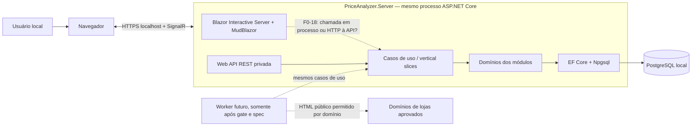
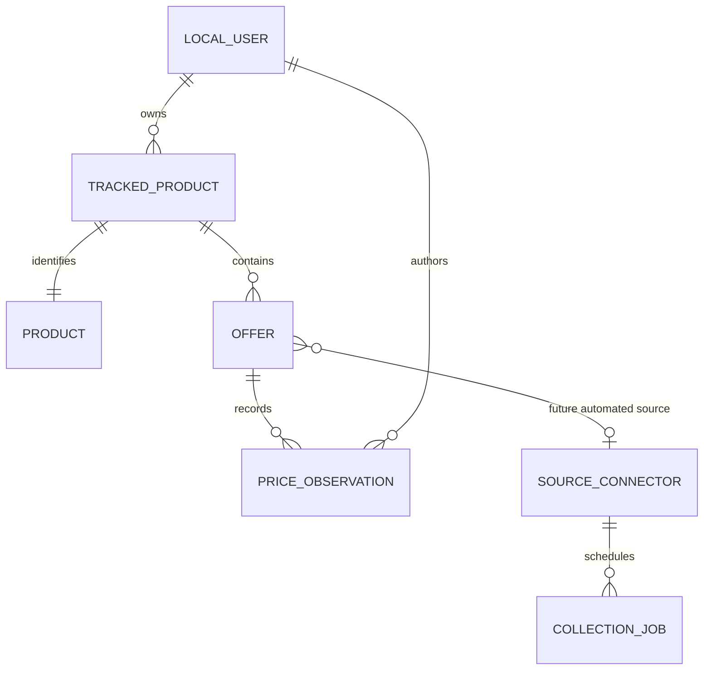

# Planejamento e arquitetura inicial — Analisador de preços

**Estado:** planejamento; nenhuma aplicação foi criada.<br>
**Nota de escopo:** aplicação local para várias contas provisionadas pelo administrador, acessível somente na máquina hospedeira. O usuário escolheu um núcleo manual para o primeiro MVP; não haverá consulta automática à Internet nesse fluxo. Em evolução futura, somente HTML público expressamente permitido nos termos poderá ser fonte automatizada. Não usar APIs, feeds, agregadores ou integrações de terceiros como fonte de dados. O sistema não contata lojas nem altera contas, anúncios, pedidos ou transações.
**Data da pesquisa:** 11–12/10/2026.
**Região inicial considerada:** Brasil; idioma pt-BR; moeda BRL.
**Direção do MVP:** cadastrar produto e ofertas manualmente por texto e/ou EAN/GTIN, registrar observações informadas pelo usuário, comparar ofertas compatíveis e analisar a variação temporal. Observações devem ser rotuladas como manuais; uma URL é somente referência e não será acessada pelo aplicativo. Nenhum domínio HTML passou pelo gate. A automação futura fica condicionada à aprovação individual do domínio e dos campos/retensão pretendidos.
**Limite do primeiro corte:** não haverá busca, crawler, chamadas a sites nem atualização automática. O sistema compara apenas o preço do item, sem frete. A frequência desejada de seis horas só se aplica a uma futura coleta aprovada. Não prometer busca exaustiva na Internet.

## 1. Objetivo do produto

O administrador local provisiona contas. Cada usuário entra no app local, informa um produto por nome ou EAN/GTIN, cadastra ofertas de diferentes lojas e registra preços manualmente. O sistema preserva observações datadas para comparar os últimos preços informados e analisar a variação por oferta. Uma URL pode ser guardada como referência, sem ser acessada pelo app.

A unidade acompanhada é o **produto**; a unidade que tem preço e vendedor é a **oferta/anúncio**. Um produto pode ter várias ofertas, em vários vendedores e sites. Cada oferta tem seu próprio histórico.

## 2. Stack e forma de implantação recomendadas

- **Frontend:** Blazor com MudBlazor, responsável pelas telas de conta, cadastro manual, acompanhamento, comparação e histórico.
- **Backend:** ASP.NET Core Web API em .NET 10 LTS; revalidar versão e patches suportados quando a implementação começar.
- **Persistência:** PostgreSQL via EF Core 10 e provider Npgsql compatível.
- **Automação futura:** Worker .NET separado poderá executar jobs persistidos de descoberta/atualização HTML quando uma fonte elegível e uma spec incremental forem aprovadas. Não há Worker nem fila de coleta no MVP manual.
- **Organização:** monólito modular com host Server (Blazor + API privada); adicionar Worker como segundo processo somente quando houver automação aprovada. Não iniciar com microserviços.
- **Interface Blazor:** Blazor Web App com renderização interativa no servidor (Interactive Server), conforme escolha do usuário.
- **Hospedagem inicial:** host ASP.NET Core e PostgreSQL são executados localmente; host/API escutam somente em loopback/localhost e PostgreSQL não é exposto à rede. A aplicação não aceita conexões de outros dispositivos da rede local.
- **Seleção de bibliotecas:** priorizar bibliotecas e componentes oficiais/suportados pela Microsoft quando atenderem aos requisitos. MudBlazor é uma escolha explícita do usuário para a camada de UI e uma exceção aprovada a essa preferência geral; acompanhar sua compatibilidade, manutenção e licença. Para outras dependências de terceiros, exigir uma lacuna concreta, justificativa e avaliação de suporte, manutenção, segurança e licença.

Com Interactive Server, eventos e componentes interativos são executados no servidor através de um circuito em tempo real. A proposta inicial é que componentes chamem os casos de uso no servidor, enquanto endpoints REST privados exponham os mesmos slices como outra entrada do próprio sistema; os componentes não fariam HTTP de volta ao host. Essa proposta ainda depende de F0-18, pois o usuário definiu Web API .NET no backend e acesso apenas pelo próprio sistema. Em qualquer opção, a API não será oferecida a clientes terceiros; manter uma única origem e sessão ASP.NET Core Identity baseada em cookie. Todos os endpoints REST validam autenticação, autorização e propriedade. Se futuramente houver clientes externos ou UI separada, reavaliar OIDC/JWT e proteção CSRF/CORS antes de mudar a implantação.

### 2.1. Base de autenticação e autorização

- **Identidade:** ASP.NET Core Identity é o sistema de usuários e contas locais, persistido em PostgreSQL. MFA é obrigatória para administradores e opcional para os demais usuários, usando TOTP em app autenticador e códigos de recuperação de uso único, sem depender de e-mail. Cada código é consumido quando usado. Se a pessoa perder o autenticador e todos os códigos, a MFA de qualquer conta só pode ser recuperada por comando local no host, disponível a qualquer pessoa com acesso local ao terminal; não há redefinição pelo app nem por e-mail. O comando solicita o login, exibe a conta correspondente e exige confirmação explícita antes do reset. Depois do reset, a conta deve cadastrar novamente o TOTP antes do acesso normal quando MFA for obrigatória ou estiver habilitada. Auditar o instante UTC, a conta alvo, o usuário do sistema operacional que executou o comando e o resultado, sem registrar segredos. O administrador local provisiona contas e redefine credenciais pelo app, definindo uma senha temporária e entregando-a diretamente ao usuário. No próximo login, esse usuário deve escolher uma nova senha antes de continuar. A senha temporária não pode ser exposta em logs nem mantida em texto puro; usar os mecanismos suportados pelo Identity. Não há cadastro público. O primeiro administrador é criado por comando local de uso único, executado no host, com senha informada sem valor padrão. O comando só pode inicializar essa conta uma vez; seu fluxo deve proteger a senha e não gravá-la em argumentos, logs ou arquivos versionados. A recuperação administrativa da credencial usa comando local no host, sem depender de e-mail, e deve usar os mecanismos suportados pelo Identity para redefinir a credencial; não gravar a senha em argumentos, logs ou arquivos versionados. Usar os mecanismos suportados do framework para senhas, bloqueio após tentativas inválidas, MFA, gestão de sessões e redefinição administrativa; não reimplementar hash/sal de senha nem o ciclo de login.
- **Blazor no navegador:** autenticação por cookie Identity, com HTTPS e atributos `Secure`, `HttpOnly` e `SameSite` apropriados. A Microsoft recomenda cookies para apps de navegador; evitar bearer tokens no `localStorage`. Páginas/fluxos de conta devem seguir a integração oficial Identity do Blazor e não executar operações de Identity diretamente em componentes interativos.
- **Web API:** a API é privada, de uso interno e sem consumidores terceiros no MVP. Exigir autenticação por padrão e liberar endpoints públicos explicitamente. Se uma requisição HTTP autenticada por cookie alterar dados, aplicar proteção antifalsificação (CSRF). A proposta é que Blazor Interactive Server invoque os mesmos casos de uso em processo; F0-18 confirma se a UI deve chamar endpoints REST.
- **Tokens:** não emitir JWT nem hospedar servidor OAuth/OIDC no MVP. ASP.NET Core Identity com cookie protegido cobre a autenticação do navegador e os fluxos internos planejados. OpenIddict não é necessário para esse escopo. Se forem adicionados clientes externos, mobile ou uma UI separada que precise de Bearer JWT, avaliar primeiro as opções oficiais/suportadas pela Microsoft. Se elas não atenderem ao requisito, selecionar um emissor OIDC confiável de terceiros com justificativa técnica e revisão de suporte, manutenção, segurança e licença. A API deve validar assinatura, emissor (`iss`), audiência (`aud`), expiração e claims; não criar endpoint artesanal para emitir JWT. Os tokens Bearer das Identity API são proprietários, não JWT padrão.
- **Autorização:** combinar políticas/claims para capacidades com autorização baseada no recurso. Toda consulta de dados privados filtra pelo usuário autenticado no servidor; não aceitar `UserId` enviado pelo navegador como prova de propriedade. Roles ficam para funções amplas (por exemplo, administração); acesso a produtos/acompanhamentos exige verificar o dono do recurso no caso de uso.
- **Identificador do usuário:** associar os dados de negócio a um identificador interno estável; se houver emissor externo, mapear o par emissor/sujeito (`iss`/`sub`) para essa conta local. Não usar e-mail como chave de propriedade nem confiar em claims de identidade que o cliente possa editar.
- **Revalidação e implantação:** manter revalidação da sessão Identity no circuito Interactive Server; persistir e proteger as chaves ASP.NET Core Data Protection entre reinícios/instâncias. O pipeline de autorização API não depende de botões ou componentes ocultos na UI.

No MVP, ASP.NET Core Identity local e cookie protegido atendem a autenticação do sistema. OIDC/JWT fica como evolução condicionada à entrada de clientes externos ou a uma mudança na topologia da aplicação; não é um requisito para o login do Blazor atual.

Referências técnicas para o planejamento do segundo fator: [MFA no ASP.NET Core](https://learn.microsoft.com/en-us/aspnet/core/security/authentication/mfa?view=aspnetcore-10.0) e [códigos de recuperação do Identity](https://learn.microsoft.com/en-us/dotnet/api/microsoft.aspnetcore.identity.data.twofactorresponse.recoverycodes?view=aspnetcore-10.0).

### 2.2. Diretrizes de interface com MudBlazor

- Integrar a versão estável compatível com a versão do .NET selecionada, acompanhar atualizações e seguir a instalação oficial: registrar `AddMudServices`, importar o namespace e referenciar os assets CSS/JavaScript necessários.
- Configurar `MudThemeProvider` e `MudPopoverProvider` no layout interativo global; registrar `MudDialogProvider` e `MudSnackbarProvider` quando os respectivos serviços forem usados. Providers e componentes consumidores devem estar no mesmo modo interativo; providers renderizados estaticamente podem impedir interações.
- Centralizar tema, cores, tipografia, espaçamentos e padrões reutilizáveis para manter consistência e evitar estilos duplicados por página. Evitar misturar frameworks CSS sem necessidade.
- Em formulários, escolher deliberadamente entre `EditForm` e `MudForm`, sem combinar os dois padrões de submissão. Campos MudBlazor podem integrar a validação Blazor; a validação visual melhora a experiência, mas os casos de uso e validadores do backend continuam sendo a autoridade para regras e segurança.
- Componentes Razor apresentam estado, capturam entradas e encaminham ações aos casos de uso. Não guardar regras de domínio, autorização, cálculos de negócio ou persistência em code-behind/componentes.
- Oferecer rótulos explícitos, mensagens de erro úteis, uso por teclado, foco previsível, contraste adequado e comportamento responsivo. Listas longas de ofertas e observações devem usar paginação/carregamento adequado, sem renderizar volumes ilimitados de uma vez.
- Usar diálogos para decisões que precisem de confirmação e notificações breves para feedback transitório; erros que bloqueiem uma operação devem permanecer visíveis junto ao contexto afetado.

## 3. Módulos de negócio e plataforma

1. **Identidade e acesso** — login, provisionamento administrativo, recuperação e autorização; dados de produto e preço são privados por conta.
2. **Catálogo de produto** — identidade do item informado manualmente: texto, EAN/GTIN e atributos de variante decididos na spec.
3. **Acompanhamento** — vínculo privado entre conta e produto; não cria busca ou job no MVP manual.
4. **Ofertas manuais** — cadastro pelo usuário de uma referência de oferta/loja, sem consultar ou validar a página pela rede.
5. **Observações** — entrada manual de preço, moeda, disponibilidade, autoria e horário; preservar o histórico. A deduplicação de leituras sem mudança por `DR-016` só se aplica à automação futura; a política de uma nova captura manual repetida permanece pendente em F0-16.
6. **Comparação e análise** — comparar preços entre ofertas compatíveis e calcular a variação de cada oferta no período.
7. **WebDiscovery condicional** — futura descoberta e extração de páginas HTML públicas de domínios aprovados; não faz parte do MVP manual.
8. **Operations condicional** — gestão e estado de conectores HTML/jobs, somente quando um incremento automatizado for aprovado.
9. **Alertas** — fora do escopo local atual; qualquer canal de notificação exige nova decisão do usuário.

## 4. Monólito modular, Clean Architecture e vertical slices

Organizar primeiro por capacidade de negócio, não por um conjunto global de pastas `Controllers/Services/Repositories`. Os módulos previstos são:

- **Accounts/Identity:** usuários, sessão, autenticação e políticas de acesso.
- **ProductCatalog:** produto canônico, EAN/GTIN, marca, modelo e variantes.
- **WebDiscovery:** fora do MVP manual. Em fase futura, somente conectores HTML para páginas públicas de domínios cuja coleta automatizada seja expressamente permitida. APIs, feeds e agregadores não são fontes.
- **PriceTracking:** acompanhamentos, ofertas manuais, proveniência e observações de preço.
- **PriceAnalysis:** comparação, métricas e séries históricas.
- **Notifications:** não incluído no MVP local; só adicionar mediante decisão futura do usuário.
- **Operations:** operações da instalação; gestão de conectores/jobs fica condicional à automação futura.

Dentro de cada módulo, organizar a aplicação por fatias verticais (casos de uso), mantendo o domínio e a infraestrutura sob a fronteira do módulo. Exemplo ilustrativo:

```text
Modules/PriceTracking/
  Domain/                   # entidades, value objects e invariantes
  Features/
    StartTracking/          # endpoint/entrada, validação, handler, resultado
      StartTracking.razor    # componente da tela deste caso de uso, se houver
      StartTrackingEndpoint.cs
      StartTrackingRequest.cs
      StartTrackingValidator.cs
      StartTrackingHandler.cs
      StartTrackingResult.cs
    AddManualOffer/         # cadastro de oferta e observação inicial
    RecordPriceObservation/ # registro manual de uma nova observação
    RemoveTracking/         # remoção do acompanhamento e dados vinculados
  Infrastructure/           # mapeamento EF Core e persistência do módulo
  Contracts/                 # contratos públicos necessários a outros módulos
```

`GetPriceHistory` pertence ao módulo `PriceAnalysis`; a listagem pertence a `PriceTracking/ListTrackedProducts`. Os nomes seguem o inventário em [`docs/specs/README.md`](specs/README.md).

**Regra de co-localização:** todos os arquivos específicos de um caso de uso ficam dentro da pasta desse caso de uso. Não espalhar endpoints, requests, validators, handlers, resultados, mapeamentos ou componentes correspondentes em pastas globais organizadas apenas pelo tipo do arquivo. Se a fatia crescer, podem existir subpastas técnicas dentro da própria pasta do caso de uso, sem mover parte dela para fora. Só extrair um arquivo para uma área compartilhada quando ele for realmente usado por mais de uma fatia e tiver um dono claro no módulo.

### Regras de dependência e responsabilidade

- **Domain:** regras invariantes e linguagem do negócio; não referencia EF Core, ASP.NET Core, Blazor, PostgreSQL nem HTTP.
- **Features/Application:** cada slice orquestra um caso de uso, valida entrada, aplica políticas de autorização pertinentes e coordena transação/saída. Interfaces ficam no módulo que precisa delas.
- **Infrastructure:** implementa persistência do núcleo manual. Um cliente HTTP/parser de domínio só é criado em uma fatia de automação aprovada e fica isolado da UI e do domínio.
- **Server/API:** endpoints REST finos traduzem HTTP para um slice; não contêm regras de negócio. O host compõe módulos, autenticação e autorização.
- **Blazor:** componentes cuidam de apresentação, estado de tela e validação de experiência. Chamam casos de uso Application no servidor; não contêm regras do produto, cálculos de preço, acesso a `DbContext` ou coleta HTTP.
- **Coesão da fatia:** mudanças em um caso de uso devem ser localizáveis e revisáveis na pasta dele; código compartilhado permanece fora apenas quando houver reutilização real, nunca para criar uma pasta genérica por tipo.
- **Worker futuro:** se necessário para um conector HTML aprovado, recebe jobs duráveis e invoca os mesmos slices/capacidades; não duplica regras. Não compõe o primeiro MVP manual.
- **Comunicação entre módulos:** usar contratos explícitos ou eventos de integração/outbox. Um módulo não consulta diretamente as tabelas, entidades internas ou `DbContext` de outro. Um único PostgreSQL pode hospedar os dados, com propriedade das tabelas definida por módulo.
- **DDD/SOLID:** definir agregados e value objects onde protegem invariantes reais; manter o shared kernel pequeno; usar abstrações nas fronteiras necessárias, sem interface/classe genérica para cada tipo por padrão.

### Componentes de implantação previstos

- `PriceAnalyzer.Server` — host ASP.NET Core que serve Blazor Interactive Server e endpoints REST versionados; composition root dos módulos, Identity e políticas.
- `PriceAnalyzer.Worker` — componente futuro condicional para descoberta HTML aprovada, atualização de ofertas e jobs; não criar no primeiro corte manual.
- `Modules/*` — módulos co-localizados na solução, cada um com Domain, Features, Infrastructure e contratos próprios. Podem ser assemblies separados para reforçar fronteiras, mantendo a implantação como monólito modular.

No MVP manual, somente `Server` e PostgreSQL são necessários. Um `Worker` poderá ser adicionado após gate e spec de automação; compartilhar a base PostgreSQL não transforma os módulos em microserviços nem permite acesso cruzado às tabelas internas.

### 4.3. Visão de módulos e chamadas do MVP

O diagrama descreve a implantação local e as fronteiras do monólito. A rota de chamada da UI para os casos de uso está marcada como pendente F0-18. A API permanece privada e autenticada; nenhum componente da interface contém regras de negócio.



No MVP manual, `Worker` e `Stores` não são iniciados nem consultados. A seta tracejada representa evolução condicionada, não uma dependência ativa.

### 4.1. Spec-Driven Development e artefatos de domínio

O projeto seguirá Spec-Driven Development (SDD): especificações aprovadas, contexto do domínio e decisões registradas guiam o desenho e a implementação. O objetivo é manter linguagem, regras e critérios de aceite rastreáveis fora do código e evitar que decisões de negócio fiquem implícitas em componentes ou handlers.

- `docs/domain/context.md` é a referência contínua para a linguagem ubíqua, conceitos, invariantes compartilhadas, limites e perguntas ainda abertas do domínio.
- Cada capacidade/caso de uso terá sua própria pasta em `docs/specs/<Modulo>/<CasoDeUso>/`, contendo `spec.md` e, quando necessário, `plan.md` e `tasks.md`. Artefatos da fatia ficam juntos, como os arquivos específicos do caso de uso no código.
- Decisões transversais de arquitetura ou produto serão registradas como ADRs em `docs/decisions/`, com contexto, alternativas, decisão, estado e consequências.
- O ciclo é: entender e atualizar o contexto -> especificar comportamento e cenários de aceite -> revisar segurança, domínio e fronteiras dos módulos -> planejar e decompor tarefas -> implementar após aprovação -> verificar contra a especificação e atualizar o conhecimento quando necessário.
- Especificações distinguem decisão aprovada, hipótese e questão aberta. Regras compartilhadas pertencem ao contexto; comportamento específico pertence à spec da fatia.
- A implementação do MVP não começa até o roadmap e o conjunto de especificações necessário para o primeiro lançamento estarem documentados e aprovados pelo usuário.

### 4.2. Estratégia de testes rastreável às specs

- Critérios de aceite nas specs recebem IDs estáveis `AC-...`; regras/invariantes compartilhadas recebem IDs `DR-...` no contexto do domínio. Os testes referenciam esses IDs para deixar visível qual comportamento aprovado protegem.
- Cada caso de uso tem testes automatizados que cobrem seus critérios de aceite, caminhos alternativos e falhas relevantes. A spec lista as classes de domínio afetadas e os critérios/regras que cada uma realiza; cada classe concreta do domínio tem testes associados a esses critérios, invariantes e comportamentos.
- Manter assemblies/projetos de teste separados do código de produção, espelhando o módulo e o caso de uso. Exemplo: `tests/Modules/PriceTracking.Tests/Features/StartTracking/`; todos os testes daquele caso de uso ficam juntos. Testes de classes de domínio ficam sob `tests/Modules/<Modulo>.Tests/Domain/` e são organizados pela classe testada.
- Testes de domínio verificam invariantes e transições; testes de caso de uso verificam resultados e efeitos observáveis; testes de integração cobrem fronteiras reais de persistência, fila, HTTP e autorização quando aplicável. A estratégia exata fica no plano da fatia.
- A matriz de rastreabilidade da spec deve apontar cada `AC-...` e `DR-...` aplicável para um ou mais testes automatizados aprovados. Evitar testes tautológicos de detalhes internos; testar o comportamento e a regra que justificam a classe.
- A implementação de uma fatia só está concluída quando seus testes relacionados passam e os critérios de aceite estão cobertos. Não definir um percentual global arbitrário de cobertura como substituto para essa rastreabilidade.
- **Proposta de framework:** MSTest com `MSTest.Sdk` e `Microsoft.Testing.Platform` como runner inicial. A documentação oficial da Microsoft recomenda `MSTest.Sdk`, apresenta configuração para .NET 10 e descreve MSTest como framework multiplataforma suportado. Fixar versões e extensões por teste de compatibilidade na implementação; não adicionar bibliotecas de assertions de terceiros sem necessidade demonstrada.
- **Estado:** proposta registrada em [`ADR-001`](decisions/ADR-001-framework-de-testes.md), ainda sujeita à revisão no gate da Fase 0.

## 5. Modelo de dados conceitual

O modelo abaixo distingue identidade de produto, acompanhamento privado, oferta manual e observações. A cardinalidade final e a possível reutilização de produto dentro da mesma conta dependem de F0-05; não implica compartilhamento entre contas.



| Entidade | Finalidade | Campos relevantes |
|---|---|---|
| `User` | Conta local provisionada pelo administrador e gerenciada pelo Identity | ID, identificador de login e estado |
| `Product` | Produto informado pela pessoa e privado por conta | OwnerId, descrição, GTIN/EAN, atributos/variante decididos na spec |
| `TrackedProduct` | Relação de acompanhamento entre uma conta e um produto | OwnerId, ProductId, estado e datas |
| `Offer` | Referência de anúncio/loja criada manualmente | ProductId, nome da loja, título, URL opcional, vendedor/condição/variante conforme spec |
| `PriceObservation` | Observação histórica manual no primeiro MVP | OfferId, origem manual, usuário autor, instante UTC, preço do item, moeda, disponibilidade |
| `SourceConnector` | Futuro conector de domínio HTML aprovado | domínio, evidência/revisão, campos, limites e estado de habilitação |
| `CollectionJob` | Futuro trabalho automatizado, somente se aprovado | tipo, conector/produto/oferta, estado, tentativas, agenda e erro resumido |
| `PriceAlert` / `Notification` | Conceitos futuros, fora do escopo atual | Só serão detalhados após nova decisão do usuário |

### Regras importantes dos dados

- Produto e anúncio são registros diferentes; anúncios de vendedores diferentes não devem ser fundidos.
- Preço é um valor decimal com moeda; não usar ponto flutuante binário.
- Guardar horário de observação em UTC e exibir no fuso do usuário.
- O MVP compara apenas o preço anunciado do item. Não solicitar CEP nem somar frete; frete pode ser reavaliado numa fase futura.
- Não misturar variantes, tamanhos, capacidade, cor, novo/usado ou kits incompatíveis na mesma comparação.
- Anúncio fora de estoque é um estado, nunca um preço zero.
- Marcar claramente observações como manuais, guardar a autoria e a proveniência acordadas e não alegar validação pela loja.
- Uma URL informada manualmente é texto de referência; o MVP não faz requisição para ela.
- Para futura coleta HTML, guardar somente os campos autorizados e necessários; não armazenar HTML bruto sem necessidade e permissão documentadas.

## 6. Contratos da Web API previstos

Rotas preliminares, não finais:

- `POST /api/v1/tracked-products` — cadastrar produto e acompanhamento para a conta atual.
- `GET /api/v1/tracked-products` e `GET /api/v1/tracked-products/{id}` — listar e consultar itens do usuário.
- `POST /api/v1/tracked-products/{id}/offers` — cadastrar oferta manual associada ao acompanhamento.
- `POST /api/v1/offers/{offerId}/observations` — registrar observação manual de preço/disponibilidade.
- `GET /api/v1/tracked-products/{id}/offers` — listar ofertas manuais do acompanhamento.
- `GET /api/v1/tracked-products/{id}/history?from=...&to=...` — série histórica.
- `GET /api/v1/tracked-products/{id}/comparison` — comparar ofertas compatíveis do produto.
- `DELETE /api/v1/tracked-products/{id}` — remover acompanhamento e os dados privados associados.
- Rotas de alerta e preferências entram depois do MVP básico.

A API deve conferir propriedade do recurso pelo usuário autenticado em cada leitura e alteração; ocultar botão na interface não é controle de acesso.

## 7. Fluxos principais

### Adicionar produto

1. Usuário informa texto ou GTIN/EAN.
2. O backend valida os dados e cria produto/acompanhamento privado, sem job de busca.
3. Usuário cadastra uma ou mais ofertas de lojas e informa os dados definidos na spec.
4. Usuário registra preço, moeda, disponibilidade e demais campos aprovados; o sistema marca a observação como manual e guarda sua autoria/proveniência.

### Acompanhar preço

1. Usuário atualiza manualmente o preço observado da oferta.
2. O backend valida propriedade, comparabilidade e regras de duplicação do histórico.
3. A tela mostra os últimos preços informados que sejam comparáveis, com data e proveniência, e o histórico/variação temporal de cada oferta. Não afirma que um valor manual continua vigente na loja.
4. Em etapa futura, um conector HTML aprovado poderá produzir observações de origem automatizada, sempre identificadas separadamente.

## 8. Estratégia de descoberta e limites

| Mecanismo | O que permite | Plano |
|---|---|---|
| Entrada manual | Usuário informa ofertas e observações, que ficam marcadas como manuais e privadas por conta. | Caminho do MVP; nenhuma requisição de rede é feita para lojas ou URLs informadas. |
| Crawler/HTML público | Poderá extrair campos de páginas públicas do próprio domínio se os termos permitirem expressamente coleta automatizada, apresentação e retenção. | Única forma de automação considerada; futura e condicionada a gate individual. Nenhum domínio está aprovado. |
| APIs, feeds, agregadores e integrações de terceiros | Fontes técnicas externas para obter dados de ofertas. | Fora do escopo vigente; exigem mudança explícita de requisito. |

No MVP, a interface informa que preços foram inseridos manualmente. Se automação HTML vier a ser aprovada, a interface identifica o domínio consultado e comunica que a cobertura se limita às fontes habilitadas; nunca promete busca em toda a Internet.

### Gate obrigatório por conector

Antes de implementar ou habilitar um conector HTML, registrar a evidência dos termos públicos, domínio/caminhos permitidos, campos, frequência, concorrência, exibição, retenção, atribuição, falhas e processo de desabilitação. `robots.txt` isoladamente não prova autorização; página acessível não significa permissão. Termos silenciosos/ambíguos mantêm o domínio desabilitado. Não contatar lojas, não usar APIs ou feeds, não alterar dados e não contornar autenticação, CAPTCHA, limites ou controles de acesso.

## 9. Requisitos não funcionais

- **Segurança:** senha e sessão tratadas por Identity; acesso por usuário conferido no backend; HTTPS, limites de requisição e logs sem segredos. O MVP manual não exige credenciais de fontes. Se uma spec futura demonstrar necessidade de segredo para domínio HTML, definir armazenamento protegido fora do repositório antes de coletá-lo; nunca incluir valores em GitHub, argumentos, logs, telemetria ou UI após salvar.
- **Proteção do repositório:** manter regras de `.gitignore` para arquivos locais de configuração/segredos e incluir verificação de segredos antes de alterações serem commitadas; ignorar arquivos não é a única barreira de proteção.
- **Privacidade:** coletar apenas dados pessoais necessários, proteger o isolamento entre contas locais, permitir exclusão de dados e revisar requisitos aplicáveis antes da distribuição.
- **Resiliência futura:** para crawler HTML aprovado, usar timeouts, limites de concorrência, backoff e isolamento por domínio; respeitar bloqueios e não contornar controles de acesso.
- **Consistência futura:** se o conector exigir processamento assíncrono, jobs persistidos e idempotentes; o MVP manual não precisa de fila ou Worker.
- **Rastreabilidade:** cada preço apresentado inclui fonte e instante da última leitura.
- **Manutenibilidade:** contrato comum para consultas de descoberta e normalização, com adaptador independente por fonte e isolamento de falhas/cotas.

## 10. Referências oficiais consultadas

- [.NET: política oficial de suporte](https://dotnet.microsoft.com/en-us/platform/support/policy/dotnet-core)
- [Microsoft Learn: ASP.NET Core Identity](https://learn.microsoft.com/en-us/aspnet/core/security/authentication/identity)
- [Microsoft Learn: opções de senha, lockout e sessão do Identity no .NET 10](https://learn.microsoft.com/en-us/aspnet/core/security/authentication/identity-configuration?view=aspnetcore-10.0)
- [Microsoft Learn: TOTP e MFA do ASP.NET Core Identity no .NET 10](https://learn.microsoft.com/en-us/aspnet/core/security/authentication/mfa?view=aspnetcore-10.0)
- [Microsoft Learn: autenticação, circuitos e antifalsificação do Blazor no .NET 10](https://learn.microsoft.com/en-us/aspnet/core/blazor/security/?view=aspnetcore-10.0)
- [Microsoft Learn: endpoints de Identity API e tokens proprietários no .NET 10](https://learn.microsoft.com/en-us/aspnet/core/security/authentication/identity-api-authorization?view=aspnetcore-10.0)
- [Microsoft Learn: modos de renderização do Blazor no .NET 10](https://learn.microsoft.com/en-us/aspnet/core/blazor/components/render-modes?view=aspnetcore-10.0)
- [Microsoft Learn: segurança e Identity no Blazor no .NET 10](https://learn.microsoft.com/en-us/aspnet/core/blazor/security/?view=aspnetcore-10.0)
- [Microsoft Learn: autorização por política](https://learn.microsoft.com/en-us/aspnet/core/security/authorization/policies?view=aspnetcore-10.0)
- [Microsoft Learn: autorização baseada em recurso](https://learn.microsoft.com/en-us/aspnet/core/security/authorization/resourcebased?view=aspnetcore-10.0)
- [Microsoft Learn: proteção antifalsificação (CSRF)](https://learn.microsoft.com/en-us/aspnet/core/security/anti-request-forgery?view=aspnetcore-10.0)
- [MudBlazor: instalação em uma aplicação Blazor](https://mudblazor.com/getting-started/installation)
- [MudBlazor: formulários e validação](https://mudblazor.com/components/form)
- [Microsoft Learn: arquiteturas web comuns e Clean Architecture para .NET](https://learn.microsoft.com/en-us/dotnet/standard/modern-web-apps-azure-architecture/common-web-application-architectures)
- [Microsoft Learn: Worker Services e BackgroundService](https://learn.microsoft.com/en-us/dotnet/core/extensions/workers)
- [Microsoft Learn: providers do EF Core](https://learn.microsoft.com/en-us/ef/core/providers/)
- [Npgsql: notas do provider EF Core 10](https://www.npgsql.org/efcore/release-notes/10.0.html)
- [Brave Search API: busca web, preços e direitos de armazenamento](https://brave.com/search/api/)
- [Google: estado da Custom Search JSON API](https://developers.google.com/custom-search/v1/overview)
- [Microsoft: encerramento das Bing Search APIs](https://learn.microsoft.com/en-us/lifecycle/announcements/bing-search-api-retirement)
- [Schema.org: Product](https://schema.org/Product)
- [Schema.org: Offer](https://schema.org/Offer)
- [Schema.org: price](https://schema.org/price)
- [IETF RFC 9309: Robots Exclusion Protocol](https://www.rfc-editor.org/rfc/rfc9309.html)
- [Google: Merchant API — gerir produtos próprios](https://developers.google.com/merchant/api/guides/products/add-manage)
- [Planalto: Lei Geral de Proteção de Dados](https://www.planalto.gov.br/ccivil_03/_ato2015-2018/2018/lei/l13709.htm)
